# ambientCG: Bricks materials

**28 assets from [ambientCG](https://ambientcg.com), dedicated to the public domain under [CC0](https://docs.ambientcg.com/license/).** Use them in any game, free or paid, and change them however you like; no credit is needed.

PBR materials as 1K and 2K JPG maps (colour, normal GL and DX, roughness, AO, displacement), one folder per resolution. 891.0 MB in all.

This is a copy kept by [zuujis-cc0](https://github.com/zuujis-cc0) so game makers can take single files from GitHub. It is not made by or affiliated with ambientCG: the originals, often in more formats and higher resolutions, are on [ambientcg.com](https://ambientcg.com). If they help you, consider [supporting ambientCG](https://www.patreon.com/ambientCG).

Every file is listed in [MANIFEST.tsv](MANIFEST.tsv) with its size and SHA-256. More free assets: [the Zuujis collection](https://github.com/zuujis-cc0/free-game-assets#readme).

| | | | |
| :-: | :-: | :-: | :-: |
| <a href="Bricks073B">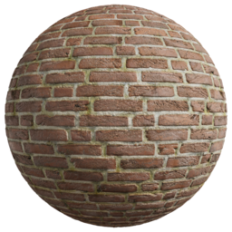</a> <b><a href="Bricks073B">Bricks 073 B</a></b> by ambientCG · <a href="https://ambientcg.com/a/Bricks073B">source</a> | <a href="Bricks073C">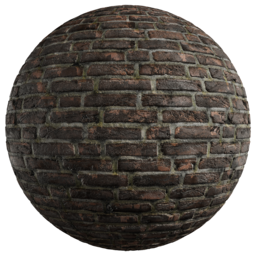</a> <b><a href="Bricks073C">Bricks 073 C</a></b> by ambientCG · <a href="https://ambientcg.com/a/Bricks073C">source</a> | <a href="Bricks074">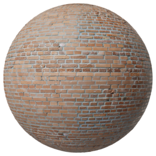</a> <b><a href="Bricks074">Bricks 074</a></b> by ambientCG · <a href="https://ambientcg.com/a/Bricks074">source</a> | <a href="Bricks075A">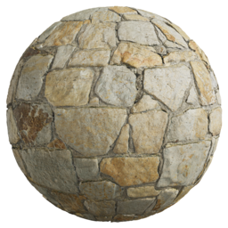</a> <b><a href="Bricks075A">Bricks 075 A</a></b> by ambientCG · <a href="https://ambientcg.com/a/Bricks075A">source</a> |
| <a href="Bricks075B">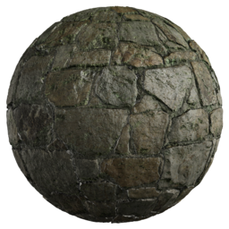</a> <b><a href="Bricks075B">Bricks 075 B</a></b> by ambientCG · <a href="https://ambientcg.com/a/Bricks075B">source</a> | <a href="Bricks076A">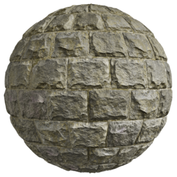</a> <b><a href="Bricks076A">Bricks 076 A</a></b> by ambientCG · <a href="https://ambientcg.com/a/Bricks076A">source</a> | <a href="Bricks076B">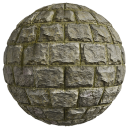</a> <b><a href="Bricks076B">Bricks 076 B</a></b> by ambientCG · <a href="https://ambientcg.com/a/Bricks076B">source</a> | <a href="Bricks076C">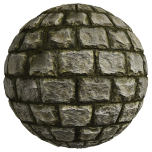</a> <b><a href="Bricks076C">Bricks 076 C</a></b> by ambientCG · <a href="https://ambientcg.com/a/Bricks076C">source</a> |
| <a href="Bricks077">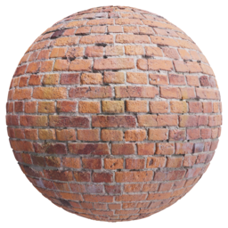</a> <b><a href="Bricks077">Bricks 077</a></b> by ambientCG · <a href="https://ambientcg.com/a/Bricks077">source</a> | <a href="Bricks078">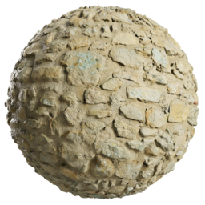</a> <b><a href="Bricks078">Bricks 078</a></b> by ambientCG · <a href="https://ambientcg.com/a/Bricks078">source</a> | <a href="Bricks079">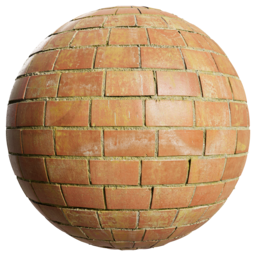</a> <b><a href="Bricks079">Bricks 079</a></b> by ambientCG · <a href="https://ambientcg.com/a/Bricks079">source</a> | <a href="Bricks080A">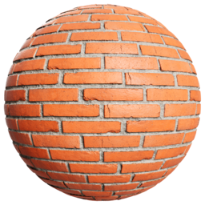</a> <b><a href="Bricks080A">Bricks 080 A</a></b> by ambientCG · <a href="https://ambientcg.com/a/Bricks080A">source</a> |
| <a href="Bricks080B">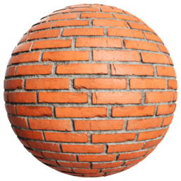</a> <b><a href="Bricks080B">Bricks 080 B</a></b> by ambientCG · <a href="https://ambientcg.com/a/Bricks080B">source</a> | <a href="Bricks080C">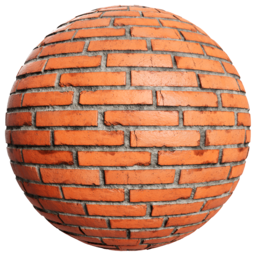</a> <b><a href="Bricks080C">Bricks 080 C</a></b> by ambientCG · <a href="https://ambientcg.com/a/Bricks080C">source</a> | <a href="Bricks081A">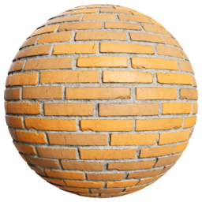</a> <b><a href="Bricks081A">Bricks 081 A</a></b> by ambientCG · <a href="https://ambientcg.com/a/Bricks081A">source</a> | <a href="Bricks081B">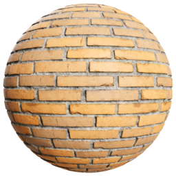</a> <b><a href="Bricks081B">Bricks 081 B</a></b> by ambientCG · <a href="https://ambientcg.com/a/Bricks081B">source</a> |
| <a href="Bricks081C">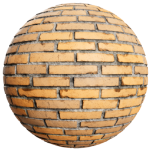</a> <b><a href="Bricks081C">Bricks 081 C</a></b> by ambientCG · <a href="https://ambientcg.com/a/Bricks081C">source</a> | <a href="Bricks082A">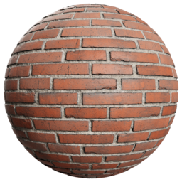</a> <b><a href="Bricks082A">Bricks 082 A</a></b> by ambientCG · <a href="https://ambientcg.com/a/Bricks082A">source</a> |  <b><a href="Bricks082B">Bricks 082 B</a></b> by ambientCG · <a href="https://ambientcg.com/a/Bricks082B">source</a> | <a href="Bricks082C">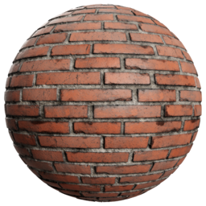</a> <b><a href="Bricks082C">Bricks 082 C</a></b> by ambientCG · <a href="https://ambientcg.com/a/Bricks082C">source</a> |
| <a href="Bricks083">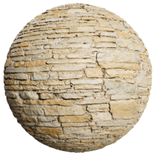</a> <b><a href="Bricks083">Bricks 083</a></b> by ambientCG · <a href="https://ambientcg.com/a/Bricks083">source</a> | <a href="Bricks084">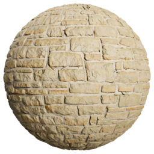</a> <b><a href="Bricks084">Bricks 084</a></b> by ambientCG · <a href="https://ambientcg.com/a/Bricks084">source</a> | <a href="Bricks085">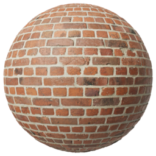</a> <b><a href="Bricks085">Bricks 085</a></b> by ambientCG · <a href="https://ambientcg.com/a/Bricks085">source</a> | <a href="Bricks086">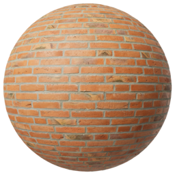</a> <b><a href="Bricks086">Bricks 086</a></b> by ambientCG · <a href="https://ambientcg.com/a/Bricks086">source</a> |
| <a href="Bricks087">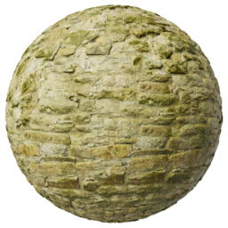</a> <b><a href="Bricks087">Bricks 087</a></b> by ambientCG · <a href="https://ambientcg.com/a/Bricks087">source</a> | <a href="Bricks088">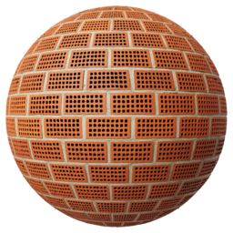</a> <b><a href="Bricks088">Bricks 088</a></b> by ambientCG · <a href="https://ambientcg.com/a/Bricks088">source</a> | <a href="Bricks089">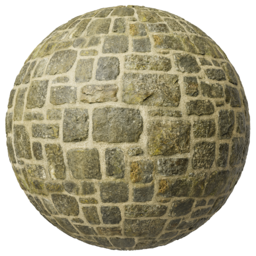</a> <b><a href="Bricks089">Bricks 089</a></b> by ambientCG · <a href="https://ambientcg.com/a/Bricks089">source</a> | <a href="Bricks090">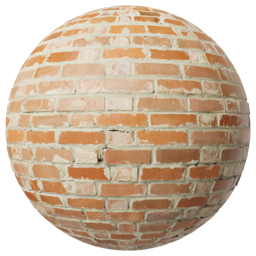</a> <b><a href="Bricks090">Bricks 090</a></b> by ambientCG · <a href="https://ambientcg.com/a/Bricks090">source</a> |

---

Kept up to date by this repository's own [update workflow](.github/workflows/update.yml), with code and plan from [cc0-mirror](https://github.com/zuujis-cc0/cc0-mirror). Something wrong? [Open an issue there](https://github.com/zuujis-cc0/cc0-mirror/issues/new) or use the [private report form](https://games.zuujis.com/report).
